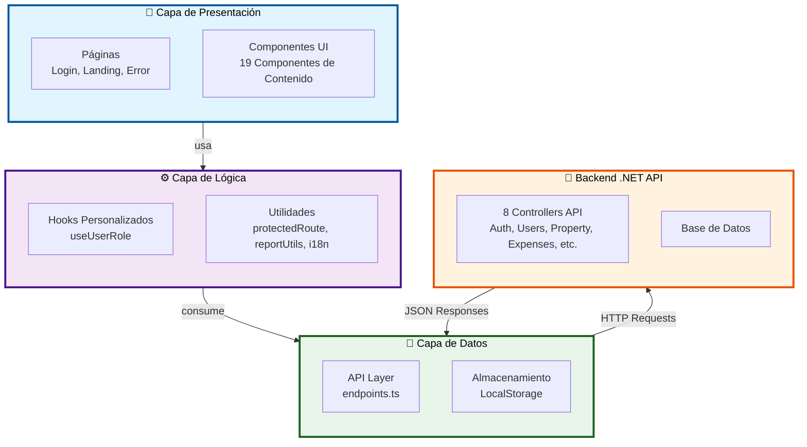
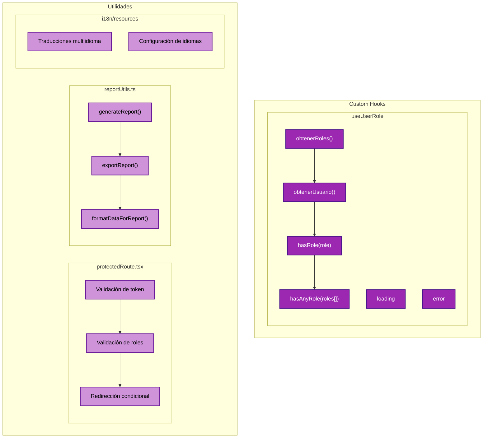
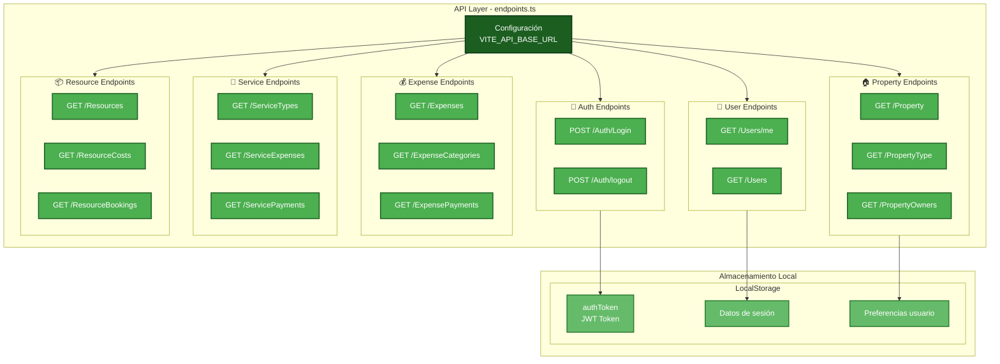
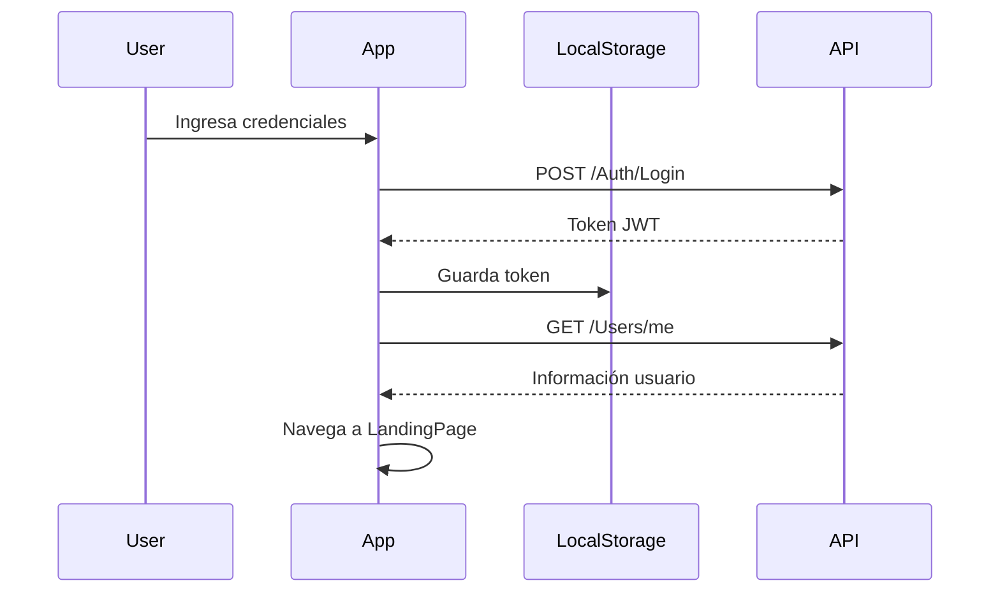
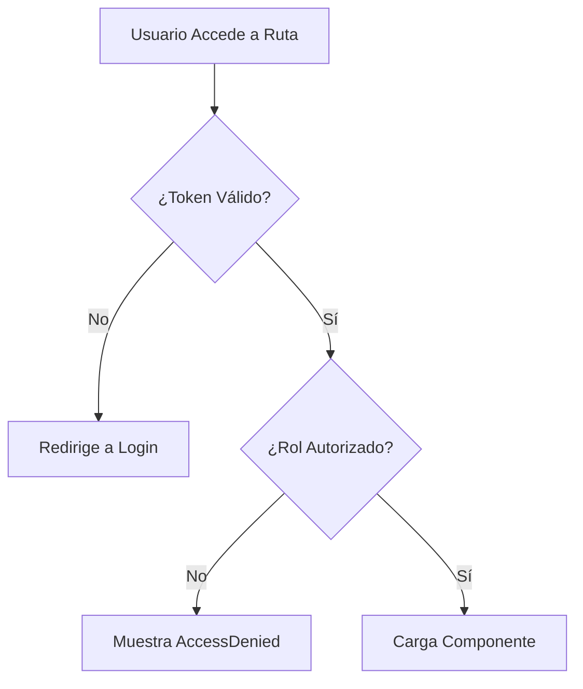
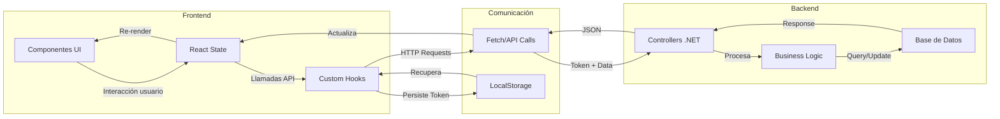

# Arquitectura Frontend - CondoAdmin

## Descripción General

CondoAdmin Frontend es una aplicación web desarrollada con **React 19** y **TypeScript**, utilizando **Vite** como herramienta de construcción y **React Router** para la navegación. La arquitectura sigue patrones modernos de componentes reutilizables con separación clara de responsabilidades.

## Stack Tecnológico

- **Framework**: React 19.1.0
- **Lenguaje**: TypeScript 5.8.3
- **Empaquetador**: Vite 7.0.4
- **Enrutamiento**: React Router DOM 7.9.4
- **Testing**: Vitest 3.2.4
- **Linting**: ESLint 9.30.1

---

## Diagrama de Arquitectura

```mermaid
graph TB
    subgraph "Capa de Presentación" LR
        App["App.tsx<br/>- Punto de entrada<br/>- Gestión de autenticación<br/>- Rutas principales"]

        subgraph "Páginas"
            LP["LoginPage<br/>- Formulario de login<br/>- Validación de credenciales"]
            LP2["LandingPage<br/>- Dashboard principal<br/>- Navegación central"]
            AP["AccessDeniedPage<br/>- Página 403"]
            NP["NotFoundPage<br/>- Página 404"]
        end

        subgraph "Componentes de Contenido" TB
            Inicio["InicioContent<br/>- Dashboard"]
            Expensas["ExpensasContent<br/>- Gestión de expensas"]
            ExpCat["ExpenseCategoriesContent<br/>- Categorías"]
            Pagos["PagosContent<br/>- Pagos de expensas"]
            Reportes["ReportesContent<br/>- Generador de reportes"]
            RV["ReportViewer<br/>- Visualizador de reportes"]

            Props["PropiedadesContent<br/>- CRUD Propiedades"]
            PropTypes["PropertyTypesContent<br/>- Tipos de propiedad"]
            PropOwners["PropertyOwnersContent<br/>- Propietarios"]

            Usuarios["UsuariosContent<br/>- Gestión usuarios"]
            Roles["RolesContent<br/>- Gestión roles"]

            Recursos["ResourcesContent<br/>- Recursos"]
            RBooking["ResourceBookingsContent<br/>- Reservas"]

            Servicios["ServiceTypesContent<br/>- Tipos de servicio"]
            ServExp["ServiceExpensesContent<br/>- Expensas servicios"]
            ServPay["ServicePaymentsContent<br/>- Pagos servicios"]

            Incidents["IncidentsContent<br/>- Incidentes"]
            IncTypes["IncidentTypesContent<br/>- Tipos incidente"]
        end
    end

    subgraph "Capa de Lógica" TB
        subgraph "Hooks Personalizados"
            Hook1["useUserRole<br/>- Gestión de roles<br/>- Permisos de usuario<br/>- Información de usuario"]
        end

        subgraph "Utilidades" TB
            ProtRoute["protectedRoute<br/>- Rutas protegidas<br/>- Validación acceso"]
            ReportUtils["reportUtils<br/>- Funciones reportes"]
            i18n["i18n/resources<br/>- Internacionalización"]
        end
    end

    subgraph "Capa de Datos" TB
        subgraph "API Layer"
            Endpoints["endpoints.ts<br/>- Configuración URLs<br/>- Definición de rutas API"]
        end

        subgraph "Almacenamiento" TB
            LocalStor["LocalStorage<br/>- Token de autenticación<br/>- Datos persistentes"]
        end
    end

    subgraph "Backend - .NET API" TB
        Auth["Auth Controller<br/>- /Auth/Login<br/>- /Auth/logout"]
        User["Users Controller<br/>- /Users<br/>- /Users/me"]
        Property["Property Controller<br/>- /Property<br/>- /PropertyType"]
        Expense["Expenses Controller<br/>- /Expenses<br/>- /ExpenseCategories"]
        Payments["Payments Controller<br/>- /ExpensePayments<br/>- /ServicePayments"]
        Resources["Resources Controller<br/>- /Resources<br/>- /ResourceBookings"]
        Services["Services Controller<br/>- /ServiceTypes<br/>- /ServiceExpenses"]
        Incidents["Incidents Controller<br/>- Gestión incidentes"]
    end

    %% Conexiones Capa de Presentación
    App --> LP
    App --> LP2
    App --> AP
    App --> NP

    LP2 --> Inicio
    LP2 --> Expensas
    LP2 --> Pagos
    LP2 --> Reportes
    LP2 --> Props
    LP2 --> Usuarios
    LP2 --> Roles
    LP2 --> Recursos
    LP2 --> Servicios
    LP2 --> Incidents

    Expensas --> ExpCat
    Pagos --> RV
    Props --> PropTypes
    Props --> PropOwners
    Usuarios --> Roles
    Recursos --> RBooking
    Servicios --> ServExp
    Servicios --> ServPay
    Incidents --> IncTypes

    %% Conexiones a Lógica
    LP --> Hook1
    LP2 --> Hook1
    Usuarios --> Hook1
    Reportes --> ReportUtils
    Props --> ProtRoute
    Pagos --> ReportUtils

    %% Conexiones a Datos
    Hook1 --> LocalStor
    LP --> Endpoints

    %% Conexiones a Backend
    Endpoints --> Auth
    Endpoints --> User
    Endpoints --> Property
    Endpoints --> Expense
    Endpoints --> Payments
    Endpoints --> Resources
    Endpoints --> Services
    Endpoints --> Incidents

    LP -.Auth Request.-> Auth
    Hook1 -.Get User Info.-> User
    Props -.CRUD.-> Property
    Expensas -.Get/Post.-> Expense
    Pagos -.Get/Post.-> Payments
    Recursos -.CRUD.-> Resources
    Servicios -.CRUD.-> Services
    Incidents -.CRUD.-> Incidents

    classDef presentation fill:#e1f5ff,stroke:#01579b,stroke-width:2px
    classDef logic fill:#f3e5f5,stroke:#4a148c,stroke-width:2px
    classDef data fill:#e8f5e9,stroke:#1b5e20,stroke-width:2px
    classDef backend fill:#fff3e0,stroke:#e65100,stroke-width:2px

    class App,LP,LP2,AP,NP,Inicio,Expensas,ExpCat,Pagos,Reportes,RV,Props,PropTypes,PropOwners,Usuarios,Roles,Recursos,RBooking,Servicios,ServExp,ServPay,Incidents,IncTypes presentation
    class Hook1,ProtRoute,ReportUtils,i18n logic
    class Endpoints,LocalStor data
    class Auth,User,Property,Expense,Payments,Resources,Services,Incidents backend
```



---

## Diagrama Simplificado de Capas



---

## Diagramas por Capa

### Capa de Presentación

```mermaid
graph TB
    subgraph AppLayer["App - Punto de Entrada"]
        App["App.tsx<br/>- Gestión autenticación global<br/>- Enrutamiento principal<br/>- Control de sesión"]
    end

    subgraph PagesLayer["Páginas - Rutas Principales"]
        LP["LoginPage<br/>Autenticación"]
        LP2["LandingPage<br/>Dashboard Principal"]
        AP["AccessDeniedPage<br/>Error 403"]
        NP["NotFoundPage<br/>Error 404"]
    end

    subgraph ModulesLayer["Módulos Funcionales"]
        subgraph Dashboard["📊 Dashboard"]
            Inicio["InicioContent"]
        end

        subgraph Expensas_M["💰 Expensas"]
            ExpensasContent["ExpensasContent"]
            ExpenseCategoriesContent["ExpenseCategoriesContent"]
        end

        subgraph Pagos_M["💳 Pagos"]
            PagosContent["PagosContent"]
            ReportViewerComp["ReportViewer"]
        end

        subgraph Properties_M["🏠 Propiedades"]
            PropiedadesContent["PropiedadesContent"]
            PropertyTypesContent["PropertyTypesContent"]
            PropertyOwnersContent["PropertyOwnersContent"]
        end

        subgraph Admin_M["👥 Administración"]
            UsuariosContent["UsuariosContent"]
            RolesContent["RolesContent"]
        end

        subgraph Resources_M["📦 Recursos"]
            ResourcesContent["ResourcesContent"]
            ResourceBookingsContent["ResourceBookingsContent"]
        end

        subgraph Services_M["🔧 Servicios"]
            ServiceTypesContent["ServiceTypesContent"]
            ServiceExpensesContent["ServiceExpensesContent"]
            ServicePaymentsContent["ServicePaymentsContent"]
        end

        subgraph Incidents_M["⚠️ Incidentes"]
            IncidentsContent["IncidentsContent"]
            IncidentTypesContent["IncidentTypesContent"]
        end
    end

    App --> LP
    App --> LP2
    App --> AP
    App --> NP

    LP2 --> Inicio
    LP2 --> ExpensasContent
    LP2 --> PagosContent
    LP2 --> PropiedadesContent
    LP2 --> UsuariosContent
    LP2 --> ResourcesContent
    LP2 --> ServiceTypesContent
    LP2 --> IncidentsContent

    classDef appStyle fill:#0277bd,stroke:#01579b,stroke-width:2px,color:#fff
    classDef pageStyle fill:#0288d1,stroke:#0277bd,stroke-width:2px,color:#fff
    classDef moduleStyle fill:#81d4fa,stroke:#0288d1,stroke-width:2px,color:#000

    class App appStyle
    class LP,LP2,AP,NP pageStyle
    class Inicio,ExpensasContent,PagosContent,PropiedadesContent,UsuariosContent,ResourcesContent,ServiceTypesContent,IncidentsContent moduleStyle
```



### Capa de Lógica



### Capa de Datos



---

## Descripción por Capas

### 1. Capa de Presentación

#### Página Principal (App.tsx)

- **Responsabilidades**:
  - Punto de entrada de la aplicación
  - Gestión global de tokens de autenticación
  - Enrutamiento principal
  - Control de sesión de usuario

#### Páginas

- **LoginPage**: Autenticación de usuarios
- **LandingPage**: Dashboard principal con navegación
- **AccessDeniedPage**: Manejo de errores 403
- **NotFoundPage**: Manejo de rutas inválidas

#### Componentes de Contenido

Módulos funcionales principales:

| Módulo          | Componentes                                                         | Funcionalidad                       |
| --------------- | ------------------------------------------------------------------- | ----------------------------------- |
| **Inicio**      | InicioContent                                                       | Dashboard y resumen general         |
| **Expensas**    | ExpensasContent, ExpenseCategoriesContent                           | Gestión de expensas y categorías    |
| **Pagos**       | PagosContent, ReportViewer                                          | Registro y seguimiento de pagos     |
| **Propiedades** | PropiedadesContent, PropertyTypesContent, PropertyOwnersContent     | CRUD de propiedades y propietarios  |
| **Usuarios**    | UsuariosContent, UsuarioContent                                     | Gestión de usuarios del sistema     |
| **Roles**       | RolesContent                                                        | Gestión de roles y permisos         |
| **Recursos**    | ResourcesContent, ResourceBookingsContent                           | Gestión de recursos comunes         |
| **Servicios**   | ServiceTypesContent, ServiceExpensesContent, ServicePaymentsContent | Gestión de servicios                |
| **Incidentes**  | IncidentsContent, IncidentTypesContent                              | Reporte y seguimiento de incidentes |

### 2. Capa de Lógica

#### Hooks Personalizados

**useUserRole**

```typescript
- Obtiene información del usuario autenticado
- Gestiona roles del usuario (admin, super, director, habitante, auxiliar, seguridad)
- Proporciona métodos para validar permisos
- Métodos: hasRole(), hasAnyRole()
```

#### Utilidades

- **protectedRoute.tsx**: Componente wrapper para proteger rutas según roles
- **reportUtils.ts**: Funciones auxiliares para generación de reportes
- **i18n/resources.ts**: Configuración de internacionalización

### 3. Capa de Datos

#### API Layer

- **endpoints.ts**: Centraliza todas las URLs de la API
  - URL base configurable vía variables de entorno
  - Definición de endpoints para cada módulo
  - Soporta parámetros dinámicos

#### Almacenamiento

- **LocalStorage**: Persiste token de autenticación y datos de sesión

---

## Flujo de Autenticación



---

## Flujo de Rutas Protegidas



---

## Estructura de Carpetas

```
CondoFE/
├── src/
│   ├── api/
│   │   └── endpoints.ts          # Configuración de endpoints
│   ├── components/               # Componentes de contenido
│   │   ├── ExpensasContent.tsx
│   │   ├── PagosContent.tsx
│   │   ├── PropiedadesContent.tsx
│   │   └── ... (14 componentes más)
│   ├── pages/                    # Páginas principales
│   │   ├── LoginPage.tsx
│   │   ├── LandingPage.tsx
│   │   ├── AccessDeniedPage.tsx
│   │   └── NotFoundPage.tsx
│   ├── hooks/                    # Hooks personalizados
│   │   └── useUserRole.ts
│   ├── utils/                    # Funciones utilitarias
│   │   ├── protectedRoute.tsx
│   │   └── reportUtils.ts
│   ├── i18n/                     # Internacionalización
│   │   └── resources.ts
│   ├── assets/                   # Recursos estáticos
│   ├── App.tsx                   # Componente raíz
│   ├── main.tsx                  # Punto de entrada
│   ├── App.css                   # Estilos globales
│   └── index.css                 # Estilos base
├── public/                        # Archivos públicos
├── vite.config.ts                # Configuración Vite
├── tsconfig.json                 # Configuración TypeScript
└── package.json                  # Dependencias y scripts
```

---

## Patrones de Diseño Utilizados

### 1. **Component Pattern**

- Componentes funcionales con Hooks
- Props bien tipadas con TypeScript

### 2. **Custom Hooks Pattern**

- `useUserRole` para gestión de autenticación y roles

### 3. **Protected Routes Pattern**

- Validación de token y roles antes de acceder a rutas
- Redirección a login o página de acceso denegado

### 4. **Centralized API Configuration**

- URLs centralizadas en `endpoints.ts`
- Configuración por variables de entorno

### 5. **Role-Based Access Control (RBAC)**

- Validación de roles en cliente
- Métodos auxiliares para verificar permisos

---

## Integraciones Principales

### Comunicación con Backend (.NET)

| Módulo            | Endpoints Consumidos                                    |
| ----------------- | ------------------------------------------------------- |
| **Autenticación** | `/Auth/Login`, `/Auth/logout`                           |
| **Usuarios**      | `/Users`, `/Users/me`                                   |
| **Propiedades**   | `/Property`, `/PropertyType`, `/PropertyOwners`         |
| **Expensas**      | `/Expenses`, `/ExpenseCategories`, `/ExpensePayments`   |
| **Pagos**         | `/PaymentStatus`, `/ServicePayments`                    |
| **Recursos**      | `/Resources`, `/ResourceCosts`, `/ResourceBookings`     |
| **Servicios**     | `/ServiceTypes`, `/ServiceExpenses`, `/ServicePayments` |
| **Reportes**      | `/Expenses` (para generar reportes)                     |
| **Incidentes**    | Endpoints para incidentes                               |

### Tipos de Datos Soportados

**Roles de Usuario**:

- `admin`: Administrador del sistema
- `super`: Super usuario
- `director`: Director del condominio
- `habitante`: Residente
- `auxiliar`: Personal auxiliar
- `seguridad`: Personal de seguridad

---

## Consideraciones de Seguridad

1. **Token JWT**: Almacenado en LocalStorage (considera usar HttpOnly cookies en producción)
2. **Validación en Cliente**: Rutas protegidas y validación de roles
3. **CORS**: Configurado en backend
4. **TypeScript**: Tipado fuerte reduce errores

---

## Flujo de Datos General



---

## Mejoras Futuras Recomendadas

1. **State Management**: Considerar Redux o Zustand para estado global más complejo
2. **Error Handling**: Implementar boundary components para capturar errores
3. **Testing**: Expandir suite de tests unitarios e integración
4. **Performance**: Implementar React.memo y Code Splitting
5. **Security**: Cambiar LocalStorage a HttpOnly cookies
6. **Logging**: Sistema centralizado de logging
7. **PWA**: Soporte para instalación como aplicación web

---

## Conclusión

La arquitectura del frontend de CondoAdmin sigue principios SOLID con separación clara de responsabilidades:

- **Presentación**: Componentes reutilizables y páginas
- **Lógica**: Hooks personalizados para casos específicos
- **Datos**: Centralización de endpoints y almacenamiento

Esta estructura facilita el mantenimiento, testing y escalabilidad de la aplicación.
