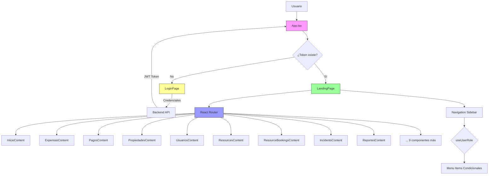
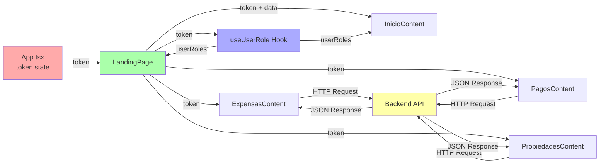

# ESTRUCTURA DE COMPONENTES - FRONTEND
## Sistema de Administración de Condominios

---

## 📋 ÍNDICE

1. [Visión General](#1-visión-general)
2. [Jerarquía de Componentes](#2-jerarquía-de-componentes)
3. [Diagrama de Arquitectura](#3-diagrama-de-arquitectura)
4. [Componentes por Nivel](#4-componentes-por-nivel)
5. [Flujo de Datos (Props)](#5-flujo-de-datos-props)
6. [Tipos de Componentes](#6-tipos-de-componentes)
7. [Componentes de Nivel 1 - Router Principal](#7-componentes-de-nivel-1---router-principal)
8. [Componentes de Nivel 2 - Layout y Navegación](#8-componentes-de-nivel-2---layout-y-navegación)
9. [Componentes de Nivel 3 - Contenido Funcional](#9-componentes-de-nivel-3---contenido-funcional)
10. [Custom Hooks](#10-custom-hooks)
11. [Patrones de Composición](#11-patrones-de-composición)
12. [Comunicación entre Componentes](#12-comunicación-entre-componentes)
13. [Ciclo de Vida de los Componentes](#13-ciclo-de-vida-de-los-componentes)

---

## 1. VISIÓN GENERAL

### 1.1 Arquitectura de Componentes

El proyecto sigue una arquitectura basada en componentes de React con **tres niveles jerárquicos principales**:

```
Nivel 1: Root/Router (App.tsx)
         ↓
Nivel 2: Layout/Container (LoginPage, LandingPage)
         ↓
Nivel 3: Feature Components (18 componentes de contenido)
```

### 1.2 Métricas de Componentes

| Métrica | Cantidad |
|---------|----------|
| **Total de Componentes** | 21 componentes |
| **Páginas** | 2 (LoginPage, LandingPage) |
| **Componentes de Contenido** | 18 módulos funcionales |
| **Custom Hooks** | 1 (useUserRole) |
| **Niveles de Jerarquía** | 3 niveles |

### 1.3 Filosofía de Diseño

- **Componentes Funcionales**: 100% de componentes usando funciones
- **Hooks**: Uso extensivo de hooks de React
- **Props Drilling**: Pasar props de forma explícita
- **Single Responsibility**: Cada componente tiene una responsabilidad única
- **Composición**: Preferir composición sobre herencia

---

## 2. JERARQUÍA DE COMPONENTES

### 2.1 Árbol Completo de Componentes

```
App (Root Component)
│
├── LoginPage
│   └── [Form Elements - Native HTML]
│
└── BrowserRouter
    └── Routes
        └── LandingPage (token)
            │
            ├── Navigation Sidebar
            │   ├── Hamburger Menu Button
            │   └── Menu Links (conditional by role)
            │       ├── Link to /
            │       ├── Link to /expensas
            │       ├── Link to /pagos
            │       ├── Link to /propiedades
            │       ├── Link to /usuarios
            │       ├── Link to /recursos
            │       ├── Link to /reservas
            │       ├── Link to /incidentes
            │       ├── Link to /reportes
            │       ├── Link to /categorias-expensas
            │       ├── Link to /tipo-propiedades
            │       ├── Link to /duenos-propiedades
            │       ├── Link to /roles
            │       ├── Link to /tipos-servicio
            │       ├── Link to /expensas-servicio
            │       ├── Link to /pagos-servicio
            │       ├── Link to /tipos-incidente
            │       └── Link to /usuario
            │
            └── Main Content Area (useRoutes)
                ├── / → InicioContent (debts, announcements, loading, userRoles)
                │       └── [Navigation Cards Grid]
                │
                ├── /expensas → ExpensasContent (token)
                │       ├── [Filters Section]
                │       ├── [Data Table]
                │       ├── [Create/Edit Form Modal]
                │       └── [Actions Buttons]
                │
                ├── /pagos → PagosContent (token)
                │       ├── [Expenses List]
                │       ├── [Payment Form]
                │       └── [Payment History]
                │
                ├── /propiedades → PropiedadesContent (token)
                │       ├── [Properties Table]
                │       ├── [Create/Edit Form]
                │       └── [Search Filters]
                │
                ├── /usuarios → UsuariosContent (token)
                │       ├── [Users Table]
                │       ├── [User Form]
                │       └── [Role Assignment]
                │
                ├── /usuario → UsuarioContent (token)
                │       ├── [User Profile Info]
                │       ├── [Edit Profile Form]
                │       └── [My Properties List]
                │
                ├── /recursos → ResourcesContent (token)
                │       ├── [Resources Table]
                │       ├── [Resource Form]
                │       ├── [Cost Configuration]
                │       └── [Photo Upload]
                │
                ├── /reservas → ResourceBookingsContent (token)
                │       ├── [Bookings Calendar]
                │       ├── [Available Resources]
                │       ├── [Booking Form]
                │       └── [My Bookings]
                │
                ├── /incidentes → IncidentsContent (token)
                │       ├── [Incidents List]
                │       ├── [Incident Form]
                │       ├── [Status Tracking]
                │       └── [Cost Assignment]
                │
                ├── /reportes → ReportesContent
                │       └── [Reports Dashboard]
                │
                ├── /categorias-expensas → ExpenseCategoriesContent (token)
                │       ├── [Categories Table]
                │       └── [Category Form]
                │
                ├── /tipo-propiedades → PropertyTypesContent (token)
                │       ├── [Property Types Table]
                │       └── [Type Form]
                │
                ├── /duenos-propiedades → PropertyOwnersContent (token)
                │       ├── [Owners-Properties Table]
                │       └── [Assignment Form]
                │
                ├── /roles → RolesContent (token)
                │       ├── [Roles Table]
                │       └── [Role Form]
                │
                ├── /tipos-servicio → ServiceTypesContent (token)
                │       ├── [Service Types Table]
                │       └── [Type Form]
                │
                ├── /expensas-servicio → ServiceExpensesContent (token)
                │       ├── [Service Expenses Table]
                │       └── [Expense Form]
                │
                ├── /pagos-servicio → ServicePaymentsContent (token)
                │       ├── [Service Payments Table]
                │       └── [Payment Form]
                │
                └── /tipos-incidente → IncidentTypesContent (token)
                        ├── [Incident Types Table]
                        └── [Type Form]
```

### 2.2 Representación Visual ASCII

```
┌─────────────────────────────────────────────────────────────┐
│                          App.tsx                             │
│                     (Root Component)                         │
│                                                              │
│  ┌────────────┐              ┌──────────────────────────┐   │
│  │ LoginPage  │────token────▶│    BrowserRouter        │   │
│  │            │              │                          │   │
│  └────────────┘              │  ┌────────────────────┐ │   │
│       ▲                      │  │   LandingPage      │ │   │
│       │                      │  │                    │ │   │
│       │ no token             │  │ ┌────────────┐   │ │   │
│       └──────────────────────┼──┤ │ Sidebar    │   │ │   │
│                              │  │ │ Navigation │   │ │   │
│                              │  │ └────────────┘   │ │   │
│                              │  │                  │ │   │
│                              │  │ ┌────────────┐  │ │   │
│                              │  │ │  useRoutes │  │ │   │
│                              │  │ │            │  │ │   │
│                              │  │ │ Content    │  │ │   │
│                              │  │ │ Components │  │ │   │
│                              │  │ └────────────┘  │ │   │
│                              │  └────────────────────┘ │   │
│                              └──────────────────────────┘   │
└─────────────────────────────────────────────────────────────┘
```

---

## 3. DIAGRAMA DE ARQUITECTURA

### 3.1 Diagrama de Flujo de Aplicación



### 3.2 Diagrama de Comunicación de Datos



---

## 4. COMPONENTES POR NIVEL

### 4.1 Nivel 1: Root Component

| Componente | Archivo | Responsabilidad | Props |
|------------|---------|-----------------|-------|
| **App** | `App.tsx` | Componente raíz, gestión de token, routing principal | - |

**Características:**
- Punto de entrada de la aplicación
- Gestión del estado del token (autenticación)
- Control de acceso a la aplicación
- Setup del BrowserRouter

### 4.2 Nivel 2: Layout Components (Páginas)

| Componente | Archivo | Responsabilidad | Props |
|------------|---------|-----------------|-------|
| **LoginPage** | `LoginPage.tsx` | Autenticación de usuarios | `onLogin: (token: string) => void` |
| **LandingPage** | `LandingPage.tsx` | Layout principal, navegación, routing secundario | `token: string` |

**Características:**
- LoginPage: Formulario de login, validación, llamada a API
- LandingPage: Sidebar navigation, content routing, role-based navigation

### 4.3 Nivel 3: Content Components (18 Módulos)

#### Módulos de Gestión Financiera

| Componente | Archivo | Props | Descripción |
|------------|---------|-------|-------------|
| **ExpensasContent** | `ExpensasContent.tsx` | `token` | CRUD de expensas ordinarias |
| **ExpenseCategoriesContent** | `ExpenseCategoriesContent.tsx` | `token` | Gestión de categorías de expensas |
| **PagosContent** | `PagosContent.tsx` | `token` | Registro y consulta de pagos |
| **ServiceExpensesContent** | `ServiceExpensesContent.tsx` | `token` | Expensas de servicios específicos |
| **ServicePaymentsContent** | `ServicePaymentsContent.tsx` | `token` | Pagos de servicios |

#### Módulos de Propiedades

| Componente | Archivo | Props | Descripción |
|------------|---------|-------|-------------|
| **PropiedadesContent** | `PropiedadesContent.tsx` | `token` | CRUD de propiedades |
| **PropertyTypesContent** | `PropertyTypesContent.tsx` | `token` | Tipos de propiedades |
| **PropertyOwnersContent** | `PropertyOwnersContent.tsx` | `token` | Relación propietarios-propiedades |

#### Módulos de Usuarios

| Componente | Archivo | Props | Descripción |
|------------|---------|-------|-------------|
| **UsuariosContent** | `UsuariosContent.tsx` | `token` | Gestión de usuarios del sistema |
| **UsuarioContent** | `UsuarioContent.tsx` | `token` | Perfil personal del usuario |
| **RolesContent** | `RolesContent.tsx` | `token` | Gestión de roles y permisos |

#### Módulos de Recursos e Incidentes

| Componente | Archivo | Props | Descripción |
|------------|---------|-------|-------------|
| **ResourcesContent** | `ResourcesContent.tsx` | `token` | Gestión de recursos compartidos |
| **ResourceBookingsContent** | `ResourceBookingsContent.tsx` | `token` | Sistema de reservas |
| **IncidentsContent** | `IncidentsContent.tsx` | `token` | Registro y seguimiento de incidentes |
| **IncidentTypesContent** | `IncidentTypesContent.tsx` | `token` | Tipos de incidentes |

#### Módulos de Configuración

| Componente | Archivo | Props | Descripción |
|------------|---------|-------|-------------|
| **ServiceTypesContent** | `ServiceTypesContent.tsx` | `token` | Tipos de servicios |

#### Módulos de Dashboard y Reportes

| Componente | Archivo | Props | Descripción |
|------------|---------|-------|-------------|
| **InicioContent** | `InicioContent.tsx` | `debts, announcements, loading, userRoles` | Dashboard principal personalizado |
| **ReportesContent** | `ReportesContent.tsx` | - | Generación de reportes |

---

## 5. FLUJO DE DATOS (PROPS)

### 5.1 Diagrama de Flujo de Props

```
┌─────────────┐
│   App.tsx   │
│             │
│ token ────────────────────────────────────┐
└─────────────┘                             │
                                            ▼
                                    ┌────────────────┐
                                    │  LandingPage   │
                                    │                │
                        ┌───────────┤  token         │
                        │           │  debts         │
                        │           │  announcements │
                        │           └────────────────┘
                        │                    │
                        │                    ├─── token ───▶ useUserRole Hook
                        │                    │                     │
                        │                    │                     ▼
                        │                    │              userRoles array
                        │                    │                     │
                        ▼                    ▼                     │
        ┌─────────────────────────┬──────────────────┐           │
        │                         │                  │           │
    ┌───┴────────┐       ┌────────┴────────┐  ┌─────┴──────┐   │
    │ Inicio     │       │ Expensas        │  │ Pagos      │   │
    │ Content    │       │ Content         │  │ Content    │   │
    │            │       │                 │  │            │   │
    │ props:     │       │ props:          │  │ props:     │   │
    │ - debts    │       │ - token         │  │ - token    │   │
    │ - announce │       │                 │  │            │   │
    │ - loading  │       │                 │  │            │   │
    │ - userRoles│◀──────┼─────────────────┼──┘            │   │
    └────────────┘       └─────────────────┘  └────────────┘   │
                                                                 │
    ┌────────────────────────────────────────────────────────────┘
    │
    │  (userRoles usado para filtrar vista de menú)
    │
    └──▶ canViewModule(userRoles, 'expensas')
         canViewModule(userRoles, 'pagos')
         canViewModule(userRoles, 'propiedades')
         ... etc.
```

### 5.2 Props por Componente

#### App.tsx
```typescript
// No recibe props
// Estado interno:
const [token, setToken] = useState<string | null>(null);
```

#### LoginPage
```typescript
interface LoginPageProps {
  onLogin: (token: string) => void;  // Callback para enviar token al padre
}
```

#### LandingPage
```typescript
interface LandingPageProps {
  token: string;  // Token JWT para autenticación
}

// Props generadas internamente:
const [debts, setDebts] = useState<Debt[]>([]);
const [announcements] = useState<string[]>([]);
const [loading, setLoading] = useState(true);
const { userRoles } = useUserRole(token);
```

#### Content Components (Patrón estándar)

**Mayoría de componentes de contenido:**
```typescript
interface ComponentContentProps {
  token: string;  // Token para autenticar peticiones al backend
}
```

**InicioContent (excepción):**
```typescript
interface InicioContentProps {
  debts: Debt[];
  announcements: string[];
  loading: boolean;
  userRoles: UserRole[];
}
```

### 5.3 Flujo de Datos Detallado

#### 1. Autenticación
```
Usuario → LoginPage → API Backend → JWT Token → App.tsx (setToken) → LandingPage
```

#### 2. Autorización
```
Token → useUserRole Hook → Decode JWT → Extract Roles → Return userRoles array
```

#### 3. Navegación
```
userRoles → canViewModule() → Boolean → Conditional Rendering de Menu Items
```

#### 4. Operaciones CRUD
```
Component → HTTP Request (con Bearer token) → Backend API → Response → Update State → Re-render
```

---

## 6. TIPOS DE COMPONENTES

### 6.1 Clasificación por Propósito

#### Container Components (Contenedores)
- **LandingPage**: Contiene lógica de navegación y routing
- **Content Components**: Contienen lógica de negocio y estado

**Características:**
- Gestionan estado local con `useState`
- Realizan side effects con `useEffect`
- Hacen llamadas a API
- Procesan datos
- Pasan datos a componentes presentacionales

#### Presentational Components (Presentación)
- Elementos HTML nativos dentro de cada componente
- No tienen lógica de negocio propia
- Reciben datos vía props
- Enfocados en la UI

**Ejemplos (implícitos en el código):**
- Formularios
- Tablas de datos
- Botones de acción
- Mensajes de feedback

### 6.2 Clasificación por Funcionalidad

#### Page Components (Páginas)
```typescript
- LoginPage
- LandingPage
```

#### Feature Components (Funcionalidades)
```typescript
// Gestión Financiera
- ExpensasContent
- ExpenseCategoriesContent
- PagosContent
- ServiceExpensesContent
- ServicePaymentsContent

// Propiedades
- PropiedadesContent
- PropertyTypesContent
- PropertyOwnersContent

// Usuarios
- UsuariosContent
- UsuarioContent
- RolesContent

// Recursos
- ResourcesContent
- ResourceBookingsContent

// Incidentes
- IncidentsContent
- IncidentTypesContent

// Configuración
- ServiceTypesContent

// Dashboard
- InicioContent
- ReportesContent
```

### 6.3 Componentes por Complejidad

#### Nivel de Complejidad Alto (800+ líneas)
```typescript
- ExpensasContent (800 líneas)
- ResourcesContent (798 líneas)
- ServiceExpensesContent (842 líneas)
- IncidentsContent (882 líneas)
```

**Características:**
- CRUD completo
- Múltiples entidades relacionadas
- Validaciones complejas
- Gestión de costos asociados

#### Nivel de Complejidad Medio (400-800 líneas)
```typescript
- PropiedadesContent (614 líneas)
- UsuariosContent (572 líneas)
- PropertyOwnersContent (623 líneas)
- ResourceBookingsContent (657 líneas)
- ServicePaymentsContent (647 líneas)
- UsuarioContent (702 líneas)
- PropertyTypesContent (500 líneas)
- RolesContent (461 líneas)
- ExpenseCategoriesContent (461 líneas)
```

**Características:**
- CRUD estándar
- 2-3 entidades relacionadas
- Validaciones básicas

#### Nivel de Complejidad Bajo (<400 líneas)
```typescript
- InicioContent (424 líneas) - Principalmente UI
- PagosContent (430 líneas)
- ServiceTypesContent (416 líneas)
- IncidentTypesContent (402 líneas)
- ReportesContent (10 líneas) - Pendiente de implementación
```

**Características:**
- Funcionalidad específica y acotada
- Operaciones simples
- Menos estados

---

## 7. COMPONENTES DE NIVEL 1 - ROUTER PRINCIPAL

### 7.1 App.tsx - Componente Raíz

```typescript
// Ubicación: src/App.tsx

function App() {
  const [token, setToken] = useState<string | null>(null);

  if (!token) {
    return <LoginPage onLogin={setToken} />;
  }

  return (
    <BrowserRouter>
      <Routes>
        <Route path="/*" element={<LandingPage token={token} />} />
        <Route path="/login" element={<LoginPage onLogin={setToken} />} />
        <Route path="*" element={<Navigate to="/" />} />
      </Routes>
    </BrowserRouter>
  );
}

export default App;
```

#### Responsabilidades

1. **Gestión de Autenticación Global**
   - Mantiene el estado del token
   - Controla el acceso a la aplicación

2. **Control de Acceso**
   - Redirige a LoginPage si no hay token
   - Permite acceso a LandingPage con token válido

3. **Routing Principal**
   - Configura BrowserRouter
   - Define rutas de nivel superior
   - Maneja rutas no encontradas

#### Flujo de Renderizado

```
App monta
    ↓
Chequea token
    ↓
┌──────────┴──────────┐
│ No token│ Con token │
↓         │           ↓
LoginPage │    BrowserRouter
          │           ↓
          │    Routes setup
          │           ↓
          └────→ LandingPage
```

---

## 8. COMPONENTES DE NIVEL 2 - LAYOUT Y NAVEGACIÓN

### 8.1 LoginPage - Autenticación

```typescript
// Ubicación: src/pages/LoginPage.tsx

interface LoginPageProps {
  onLogin: (token: string) => void;
}

const LoginPage: React.FC<LoginPageProps> = ({ onLogin }) => {
  const [login, setLogin] = useState('');
  const [password, setPassword] = useState('');
  const [error, setError] = useState('');
  const [loading, setLoading] = useState(false);
  const [lang, setLang] = useState<SupportedLang>('en');
  
  const handleSubmit = async (e: React.FormEvent) => {
    // Lógica de login
    const response = await fetch(ENDPOINTS.login, { /* ... */ });
    const data = await response.json();
    onLogin(data.token);
  };
  
  return (
    <div>
      {/* Selector de idioma */}
      {/* Formulario de login */}
      {/* Mensajes de error */}
      {/* Botón de submit con loading state */}
    </div>
  );
};
```

#### Características

- **Multi-idioma**: Selector ES/EN
- **Validación**: Campos requeridos
- **Feedback**: Mensajes de error
- **Loading State**: Botón deshabilitado durante carga
- **Callback**: Envía token al padre con `onLogin()`

### 8.2 LandingPage - Layout Principal

```typescript
// Ubicación: src/pages/LandingPage.tsx

interface LandingPageProps {
  token: string;
}

const LandingPage: React.FC<LandingPageProps> = ({ token }) => {
  const { userRoles } = useUserRole(token);
  const [debts, setDebts] = useState<Debt[]>([]);
  const [sidebarOpen, setSidebarOpen] = useState(false);
  const [announcements] = useState<string[]>([]);
  const [loading, setLoading] = useState(true);
  const location = useLocation();
  
  return (
    <div>
      {/* Hamburger Menu Button */}
      {/* Navigation Sidebar */}
      {/* Main Content Area con useRoutes */}
      {/* Responsive Styles */}
    </div>
  );
};
```

#### Estructura Interna

**1. Hamburger Menu Button**
```typescript
<button onClick={() => setSidebarOpen(!sidebarOpen)}>
  &#9776;  {/* Icono hamburguesa */}
</button>
```

**2. Navigation Sidebar**
```typescript
<nav style={{ width: sidebarOpen ? 200 : 0 }}>
  <ul>
    {canViewModule(userRoles, 'expensas') && (
      <li><Link to="/expensas">Expensas</Link></li>
    )}
    {/* ... más links condicionales ... */}
  </ul>
</nav>
```

**3. Main Content Area**
```typescript
<main>
  {useRoutes([
    { path: '/', element: <InicioContent {...} /> },
    { path: '/expensas', element: <ExpensasContent token={token} /> },
    { path: '/pagos', element: <PagosContent token={token} /> },
    // ... 15 rutas más ...
  ])}
</main>
```

#### Responsabilidades

1. **Layout del Dashboard**
   - Estructura de la página (sidebar + content)
   - Responsive design (desktop/mobile)

2. **Navegación**
   - Menu lateral con links
   - Control de visibilidad del sidebar
   - Indicador de ruta activa

3. **Autorización de UI**
   - Muestra/oculta menú según rol
   - Utiliza `useUserRole` hook
   - Aplica `canViewModule()` function

4. **Routing Secundario**
   - Define rutas internas con `useRoutes`
   - Pasa props necesarios a componentes hijos

---

## 9. COMPONENTES DE NIVEL 3 - CONTENIDO FUNCIONAL

### 9.1 Patrón Común de Content Components

Todos los componentes de contenido funcional siguen un patrón similar:

```typescript
// Patrón Genérico
const ComponentContent: React.FC<{token: string}> = ({ token }) => {
  // ===== ESTADO =====
  const [data, setData] = useState([]);
  const [loading, setLoading] = useState(false);
  const [selectedItem, setSelectedItem] = useState(null);
  const [isEditing, setIsEditing] = useState(false);
  const [isCreating, setIsCreating] = useState(false);
  const [formData, setFormData] = useState({});
  const [message, setMessage] = useState(null);
  
  // ===== HOOKS =====
  const { userRoles } = useUserRole(token);  // Algunos componentes
  
  // ===== FUNCIONES DE FETCH =====
  const fetchData = useCallback(async () => {
    setLoading(true);
    try {
      const response = await fetch(ENDPOINTS.someEndpoint, {
        headers: { 'Authorization': `Bearer ${token}` }
      });
      const data = await response.json();
      setData(data);
    } catch (error) {
      setMessage({ text: 'Error', type: 'error' });
    } finally {
      setLoading(false);
    }
  }, [token]);
  
  // ===== OPERACIONES CRUD =====
  const createItem = async () => { /* POST */ };
  const updateItem = async () => { /* PUT */ };
  const deleteItem = async () => { /* DELETE */ };
  
  // ===== HANDLERS =====
  const handleInputChange = (e) => { /* ... */ };
  const handleSubmit = (e) => { /* ... */ };
  const handleEdit = (item) => { /* ... */ };
  const handleDelete = (id) => { /* ... */ };
  
  // ===== EFFECTS =====
  useEffect(() => {
    fetchData();
  }, [fetchData]);
  
  // ===== RENDER =====
  return (
    <div>
      {/* Header con título y botón crear */}
      {/* Filtros y búsqueda */}
      {loading ? <p>Cargando...</p> : (
        <>
          {/* Tabla/Lista de datos */}
          {/* Formulario create/edit */}
          {/* Mensajes de feedback */}
        </>
      )}
    </div>
  );
};
```

### 9.2 Estructura Detallada por Componente

#### ExpensasContent

```typescript
interface Expense {
  id: number;
  categoryId: number;
  propertyId: number;
  startDate: string;
  paymentLimitDate: string;
  amount: number;
  interestAmount: number;
  interestRate: number;
  description: string;
  statusId: number;
  // ... campos derivados
}

interface ExpensasContentProps {
  token: string;
}

const ExpensasContent: React.FC<ExpensasContentProps> = ({ token }) => {
  // Estados para:
  // - expenses: Expense[]
  // - properties: Property[]
  // - expenseCategories: ExpenseCategory[]
  // - paymentStatuses: PaymentStatus[]
  
  // Funciones para:
  // - fetchExpenses()
  // - fetchProperties()
  // - fetchExpenseCategories()
  // - fetchPaymentStatuses()
  // - createExpense()
  // - updateExpense()
  // - deleteExpense()
  
  // Render:
  // - Tabla de expensas con todas las columnas
  // - Formulario con múltiples selects (propiedad, categoría, status)
  // - Cálculo de intereses
  // - Validaciones de fechas y montos
};
```

#### PropiedadesContent

```typescript
interface Property {
  id: number;
  legalId: string;
  tower: string;
  floor: number;
  code: string;
  propertyType: number;
  startDate: string;
  endDate?: string;
}

const PropiedadesContent: React.FC<{token: string}> = ({ token }) => {
  // Estados para:
  // - properties: Property[]
  // - propertyTypes: PropertyType[]
  
  // Funciones para:
  // - fetchProperties()
  // - fetchPropertyTypes()
  // - createProperty()
  // - updateProperty()
  // - deleteProperty()
  
  // Render:
  // - Tabla con info de propiedades
  // - Filtros por torre, piso, tipo
  // - Formulario con validación de código único
};
```

#### ResourcesContent

```typescript
interface Resource {
  id: number;
  name: string;
  description: string;
  startDate: string;
  endDate?: string | null;
  photo?: string;
}

interface ResourceCost {
  id: number;
  resourceId: number;
  bookingPrice: number;
  bookingWarrantyCost: number;
  startDate: string;
}

const ResourcesContent: React.FC<{token: string}> = ({ token }) => {
  // Estados para:
  // - resources: Resource[]
  // - resourceCosts: Map<number, ResourceCost>
  // - currentCost: ResourceCost | null
  
  // Funciones para:
  // - fetchResources()
  // - fetchResourceCost(resourceId)
  // - saveResourceCost(resourceId)
  // - createResource()
  // - updateResource()
  // - deactivateResource()
  
  // Características especiales:
  // - Gestión de costos por recurso
  // - Historial de precios
  // - Upload de foto (previsto)
};
```

#### InicioContent (Dashboard)

```typescript
interface NavigationCard {
  title: string;
  description: string;
  icon: React.ReactElement;
  path: string;
  color: string;
  module: string;
}

interface InicioContentProps {
  debts: Debt[];
  announcements: string[];
  loading: boolean;
  userRoles: UserRole[];
}

const InicioContent: React.FC<InicioContentProps> = (props) => {
  const navigate = useNavigate();
  
  // Array de NavigationCards (18 tarjetas)
  const navigationCards: NavigationCard[] = [ /* ... */ ];
  
  // Filtrar tarjetas según permisos
  const visibleCards = navigationCards.filter(card => 
    canViewModule(userRoles, card.module)
  );
  
  // Render:
  // - Header con bienvenida
  // - Grid de tarjetas de navegación
  // - Resumen de deudas
  // - Anuncios del condominio
  // - Estadísticas rápidas
};
```

### 9.3 Matriz de Componentes vs Operaciones

| Componente | Create | Read | Update | Delete | Otros |
|------------|--------|------|--------|--------|-------|
| ExpensasContent | ✅ | ✅ | ✅ | ✅ | Cálculo intereses |
| PagosContent | ✅ | ✅ | ❌ | ❌ | Registro de pago |
| PropiedadesContent | ✅ | ✅ | ✅ | ✅ | Filtros avanzados |
| UsuariosContent | ✅ | ✅ | ✅ | ✅ | Asignación de roles |
| UsuarioContent | ❌ | ✅ | ✅ | ❌ | Perfil personal |
| ResourcesContent | ✅ | ✅ | ✅ | ⚠️ | Desactivar (no delete) |
| ResourceBookingsContent | ✅ | ✅ | ❌ | ✅ | Calendario |
| IncidentsContent | ✅ | ✅ | ✅ | ❌ | Costos, estados |
| ExpenseCategoriesContent | ✅ | ✅ | ✅ | ✅ | - |
| PropertyTypesContent | ✅ | ✅ | ✅ | ✅ | - |
| PropertyOwnersContent | ✅ | ✅ | ✅ | ✅ | Relación N:M |
| RolesContent | ✅ | ✅ | ✅ | ✅ | - |
| ServiceTypesContent | ✅ | ✅ | ✅ | ✅ | - |
| ServiceExpensesContent | ✅ | ✅ | ✅ | ✅ | - |
| ServicePaymentsContent | ✅ | ✅ | ✅ | ✅ | - |
| IncidentTypesContent | ✅ | ✅ | ✅ | ✅ | - |
| InicioContent | ❌ | ✅ | ❌ | ❌ | Solo visualización |
| ReportesContent | ❌ | ✅ | ❌ | ❌ | Generación reportes |

---

## 10. CUSTOM HOOKS

### 10.1 useUserRole Hook

```typescript
// Ubicación: src/hooks/useUserRole.ts

export type UserRole = 
  | 'admin' 
  | 'super' 
  | 'director' 
  | 'habitante' 
  | 'auxiliar' 
  | 'seguridad';

interface UserInfo {
  id: number;
  userName: string;
  roles: UserRole[];
}

interface UseUserRoleReturn {
  userRoles: UserRole[];
  userInfo: UserInfo | null;
  loading: boolean;
  error: string | null;
  hasRole: (role: UserRole) => boolean;
  hasAnyRole: (roles: UserRole[]) => boolean;
}

export const useUserRole = (token: string): UseUserRoleReturn => {
  const [userRoles, setUserRoles] = useState<UserRole[]>([]);
  const [userInfo, setUserInfo] = useState<UserInfo | null>(null);
  const [loading, setLoading] = useState(true);
  const [error, setError] = useState<string | null>(null);

  useEffect(() => {
    if (!token) {
      setLoading(false);
      return;
    }

    try {
      // Decodificar JWT
      const tokenPayload = token.split('.')[1];
      const decodedToken = JSON.parse(atob(tokenPayload));
      
      // Extraer información
      const userId = parseInt(decodedToken['...nameidentifier']);
      const userName = decodedToken['...name'];
      const tokenRoles = decodedToken['...role'];
      
      // Mapear roles
      const mappedRoles = (tokenRoles || [])
        .map(mapRoleToEnum)
        .filter(Boolean);
      
      setUserInfo({ id: userId, userName, roles: mappedRoles });
      setUserRoles(mappedRoles);
    } catch (error) {
      setError('Error loading user information');
      setUserRoles(['habitante']); // Default por seguridad
    } finally {
      setLoading(false);
    }
  }, [token]);

  const hasRole = (role: UserRole): boolean => {
    return userRoles.includes(role);
  };

  const hasAnyRole = (roles: UserRole[]): boolean => {
    return roles.some(role => userRoles.includes(role));
  };

  return { userRoles, userInfo, loading, error, hasRole, hasAnyRole };
};
```

#### Uso del Hook

**En LandingPage:**
```typescript
const LandingPage: React.FC<{token: string}> = ({ token }) => {
  const { userRoles } = useUserRole(token);
  
  return (
    <nav>
      {canViewModule(userRoles, 'expensas') && (
        <Link to="/expensas">Expensas</Link>
      )}
    </nav>
  );
};
```

**En Content Components:**
```typescript
const ExpensasContent: React.FC<{token: string}> = ({ token }) => {
  const { userRoles } = useUserRole(token);
  const isAdmin = userRoles.includes('admin') || userRoles.includes('super');
  
  return (
    <div>
      {isAdmin && (
        <button>Eliminar Expensa</button>
      )}
    </div>
  );
};
```

### 10.2 Función Helper: canViewModule

```typescript
// Ubicación: src/hooks/useUserRole.ts

export const canViewModule = (
  userRoles: UserRole[], 
  module: string
): boolean => {
  if (!userRoles || userRoles.length === 0) return false;

  const permissions: { [key in UserRole]: string[] } = {
    admin: [
      'inicio', 'expensas', 'pagos', 'categorias-expensas', 
      'expensas-servicio', 'pagos-servicio', 'tipos-servicio',
      'propiedades', 'tipo-propiedades', 'usuario', 'usuarios', 
      'duenos-propiedades', 'roles', 'reportes',
      'recursos', 'reservas', 'incidentes', 'tipos-incidente'
    ],
    super: [ /* mismo que admin */ ],
    director: [
      'inicio', 'expensas', 'pagos', 'expensas-servicio', 
      'propiedades', 'usuario', 'reportes',
      'recursos', 'reservas', 'incidentes'
    ],
    habitante: [
      'inicio', 'pagos', 'propiedades', 'usuario',
      'recursos', 'reservas', 'incidentes'
    ],
    auxiliar: [
      'inicio', 'expensas', 'pagos', 'categorias-expensas', 
      'expensas-servicio', 'propiedades', 'tipo-propiedades', 
      'usuario', 'usuarios', 'duenos-propiedades', 'reportes',
      'recursos', 'reservas', 'incidentes'
    ],
    seguridad: [
      'inicio', 'usuario', 'incidentes'
    ]
  };

  return userRoles.some(role => 
    permissions[role]?.includes(module)
  );
};
```

---

## 11. PATRONES DE COMPOSICIÓN

### 11.1 Patrón Container/Presentational

Aunque no están explícitamente separados en archivos distintos, los componentes siguen este patrón internamente:

```typescript
// CONTAINER LOGIC (Inicio del componente)
const ExpensasContent: React.FC<Props> = ({ token }) => {
  // Estados
  const [expenses, setExpenses] = useState([]);
  
  // Lógica de negocio
  const fetchExpenses = async () => { /* ... */ };
  const handleDelete = async (id) => { /* ... */ };
  
  // PRESENTATIONAL PART (Return JSX)
  return (
    <div>
      {expenses.map(expense => (
        <ExpenseRow 
          key={expense.id}
          expense={expense}
          onDelete={handleDelete}
        />
      ))}
    </div>
  );
};
```

### 11.2 Patrón Render Props (Implícito)

```typescript
// Conditional Rendering Pattern
{canViewModule(userRoles, 'expensas') && (
  <MenuItem />
)}

{loading ? <LoadingSpinner /> : <DataTable />}

{error && <ErrorMessage text={error} />}
```

### 11.3 Patrón Custom Hook

```typescript
// Extracción de lógica reutilizable
const useUserRole = (token: string) => {
  // Lógica compleja de autorización
  return { userRoles, hasRole, hasAnyRole };
};

// Uso en múltiples componentes
const Component = () => {
  const { userRoles } = useUserRole(token);
  // ...
};
```

### 11.4 Patrón Compound Components (Implícito)

```typescript
// LandingPage actúa como compound component
<LandingPage token={token}>
  {/* Sidebar Component */}
  {/* Main Content Component */}
  {/* Responsive Styles */}
</LandingPage>
```

### 11.5 Patrón Higher-Order Component (Conceptual)

El hook `useUserRole` funciona conceptualmente como un HOC:

```typescript
// En lugar de:
// export default withAuth(ExpensasContent);

// Se usa:
const ExpensasContent = ({ token }) => {
  const { userRoles } = useUserRole(token);
  // Componente ahora tiene capacidades de autorización
};
```

---

## 12. COMUNICACIÓN ENTRE COMPONENTES

### 12.1 Padre a Hijo (Props)

```typescript
// App → LoginPage
<LoginPage onLogin={setToken} />

// App → LandingPage
<LandingPage token={token} />

// LandingPage → InicioContent
<InicioContent 
  debts={debts}
  announcements={announcements}
  loading={loading}
  userRoles={userRoles}
/>

// LandingPage → ExpensasContent
<ExpensasContent token={token} />
```

### 12.2 Hijo a Padre (Callbacks)

```typescript
// LoginPage → App
interface LoginPageProps {
  onLogin: (token: string) => void;
}

// LoginPage ejecuta:
onLogin(tokenRecibido);

// App recibe y actualiza estado:
const [token, setToken] = useState<string | null>(null);
<LoginPage onLogin={setToken} />
```

### 12.3 Hermanos (Via Padre Común)

**Ejemplo: Compartir userRoles entre componentes**

```typescript
// LandingPage (padre común)
const { userRoles } = useUserRole(token);

return (
  <>
    <Sidebar userRoles={userRoles} />  {/* Hermano 1 */}
    <InicioContent userRoles={userRoles} />  {/* Hermano 2 */}
  </>
);
```

### 12.4 Comunicación con Backend

```typescript
// Componente → Backend
const response = await fetch(ENDPOINTS.expenses, {
  method: 'GET',
  headers: { 
    'Authorization': `Bearer ${token}`,
    'Content-Type': 'application/json'
  }
});

// Backend → Componente
const data = await response.json();
setExpenses(data);
```

### 12.5 Diagrama de Comunicación Completo

```
┌─────────────────────────────────────────────────────┐
│                    Usuario                          │
└──────────────┬──────────────────────────────────────┘
               │
               │ Interacción
               ▼
┌─────────────────────────────────────────────────────┐
│                    App.tsx                          │
│  token: string | null                               │
└──────────┬─────────────────────────────┬────────────┘
           │                             │
           │ Props                       │ Props
           │ (onLogin callback)          │ (token)
           │                             │
      ┌────▼─────┐                  ┌────▼────────────┐
      │LoginPage │                  │  LandingPage    │
      └────┬─────┘                  └────┬────────────┘
           │                             │
           │ Callback                    │ Props & Hook
           │ onLogin(token)              │
           │                             ├─→ useUserRole(token)
           └─────────────────────────────┤     └─→ Extract roles
                                         │
                                         ├─→ Sidebar (userRoles)
                                         │
                                         ├─→ InicioContent
                                         │   (debts, announcements, userRoles)
                                         │
                                         ├─→ ExpensasContent (token)
                                         │       │
                                         │       ├─→ fetch API
                                         │       └─→ update state
                                         │
                                         └─→ [17 componentes más] (token)
                                                 │
                                                 └─→ fetch API
                                                 └─→ update state
```

---

## 13. CICLO DE VIDA DE LOS COMPONENTES

### 13.1 App.tsx - Ciclo de Vida

```
┌───────────────────────────────────┐
│ App Component Mount               │
├───────────────────────────────────┤
│ 1. Inicialización                 │
│    - const [token, setToken] = useState(null) │
│                                   │
│ 2. Render Inicial                 │
│    - Evalúa: if (!token)          │
│    - Renderiza: LoginPage         │
│                                   │
│ 3. Usuario hace login             │
│    - LoginPage ejecuta onLogin()  │
│    - setToken(nuevoToken)         │
│                                   │
│ 4. Re-render (token cambió)       │
│    - Evalúa: if (!token) → false  │
│    - Renderiza: BrowserRouter     │
│    - Monta: LandingPage           │
│                                   │
│ 5. Estado estable                 │
│    - LandingPage permanece        │
│    - Navegación interna activa    │
└───────────────────────────────────┘
```

### 13.2 LandingPage - Ciclo de Vida

```
┌───────────────────────────────────┐
│ LandingPage Mount                 │
├───────────────────────────────────┤
│ 1. Recibe props                   │
│    - token: string                │
│                                   │
│ 2. Inicialización de estado       │
│    - setState inicial             │
│    - useUserRole(token) ejecuta   │
│                                   │
│ 3. useEffect de useUserRole       │
│    - Decodifica token             │
│    - Extrae roles                 │
│    - setUserRoles([...])          │
│                                   │
│ 4. useEffect de fetchProperties   │
│    - fetch(ENDPOINTS.property)    │
│    - setDebts(data)               │
│    - setLoading(false)            │
│                                   │
│ 5. Render Final                   │
│    - Sidebar con menú filtrado    │
│    - Content area con routes      │
│                                   │
│ 6. Navegación interna             │
│    - Usuario hace clic en link    │
│    - useRoutes cambia contenido   │
│    - NO unmount de LandingPage    │
└───────────────────────────────────┘
```

### 13.3 Content Component - Ciclo de Vida (Ejemplo: ExpensasContent)

```
┌───────────────────────────────────┐
│ ExpensasContent Mount             │
├───────────────────────────────────┤
│ 1. Recibe props                   │
│    - token: string                │
│                                   │
│ 2. Inicialización de estado       │
│    - expenses: []                 │
│    - properties: []               │
│    - categories: []               │
│    - loading: false               │
│    - selectedExpense: null        │
│    - isEditing: false             │
│    - isCreating: false            │
│    - formData: {}                 │
│    - message: null                │
│                                   │
│ 3. useEffect ejecuta              │
│    - fetchExpenses()              │
│    ├─ setLoading(true)            │
│    ├─ fetch API                   │
│    ├─ setExpenses(data)           │
│    └─ setLoading(false)           │
│                                   │
│ 4. useEffect ejecuta              │
│    - fetchProperties()            │
│    - fetchExpenseCategories()     │
│    - fetchPaymentStatuses()       │
│                                   │
│ 5. Render inicial completo        │
│    - Muestra tabla con datos      │
│                                   │
│ 6. Interacciones del usuario      │
│    - Click "Crear"                │
│    ├─ setIsCreating(true)         │
│    └─ Re-render (muestra form)    │
│                                   │
│    - Submit formulario            │
│    ├─ createExpense()             │
│    ├─ fetch POST                  │
│    ├─ fetchExpenses() refresh     │
│    └─ setMessage({ success })     │
│                                   │
│    - Click "Editar"               │
│    ├─ setSelectedExpense(item)    │
│    ├─ setIsEditing(true)          │
│    └─ Re-render (form con datos)  │
│                                   │
│    - Click "Eliminar"             │
│    ├─ deleteExpense(id)           │
│    ├─ fetch DELETE                │
│    ├─ fetchExpenses() refresh     │
│    └─ setMessage({ success })     │
│                                   │
│ 7. Navegación a otra ruta         │
│    - ExpensasContent unmount      │
│    - Limpieza de estado           │
└───────────────────────────────────┘
```

### 13.4 useUserRole Hook - Ciclo de Vida

```
┌───────────────────────────────────┐
│ useUserRole Hook                  │
├───────────────────────────────────┤
│ 1. Invocación                     │
│    - const { userRoles } = useUserRole(token) │
│                                   │
│ 2. Inicialización                 │
│    - userRoles: []                │
│    - userInfo: null               │
│    - loading: true                │
│    - error: null                  │
│                                   │
│ 3. useEffect ejecuta              │
│    - Dependencia: [token]         │
│    - Si no hay token → return     │
│                                   │
│ 4. Procesamiento del token        │
│    - Split token por '.'          │
│    - atob(tokenPayload)           │
│    - JSON.parse()                 │
│                                   │
│ 5. Extracción de datos            │
│    - userId                       │
│    - userName                     │
│    - Roles array                  │
│                                   │
│ 6. Mapeo de roles                 │
│    - mapRoleToEnum()              │
│    - Normalización                │
│                                   │
│ 7. Actualización de estado        │
│    - setUserInfo({...})           │
│    - setUserRoles([...])          │
│    - setLoading(false)            │
│                                   │
│ 8. Return de valores             │
│    - userRoles                    │
│    - userInfo                     │
│    - loading                      │
│    - error                        │
│    - hasRole()                    │
│    - hasAnyRole()                 │
│                                   │
│ 9. Componente usa valores         │
│    - canViewModule(userRoles, 'expensas') │
│    - Conditional rendering        │
└───────────────────────────────────┘
```

---

## RESUMEN Y CONCLUSIONES

### Características de la Arquitectura de Componentes

✅ **Modular**: 21 componentes bien separados por funcionalidad
✅ **Escalable**: Fácil agregar nuevos módulos siguiendo el patrón existente
✅ **Mantenible**: Código organizado con responsabilidades claras
✅ **Reutilizable**: Custom hooks y funciones helper compartidas
✅ **Tipado Fuerte**: TypeScript con interfaces bien definidas
✅ **Consistente**: Patrón común en todos los content components

### Fortalezas de la Estructura

1. **Clara separación de responsabilidades**
   - Routing en App.tsx
   - Layout en LandingPage
   - Lógica de negocio en Content Components

2. **Autorización integrada**
   - useUserRole hook reutilizable
   - canViewModule function helper
   - Control granular por módulo

3. **Patrón CRUD consistente**
   - Todos los componentes siguen la misma estructura
   - Fácil de entender y mantener
   - Código predecible

4. **Comunicación clara**
   - Props drilling explícito
   - Callbacks bien definidos
   - Token pasado a través de la jerarquía

### Áreas de Mejora Potencial

1. **Context API para token**
   - Evitar props drilling del token
   - Simplificar paso de props

2. **Separar lógica de presentación**
   - Extraer lógica a custom hooks adicionales
   - Componentes más enfocados en UI

3. **Componentes presentacionales reutilizables**
   - DataTable genérico
   - FormModal genérico
   - ActionButtons genérico

4. **Lazy Loading**
   - Cargar componentes bajo demanda
   - Mejorar tiempo de carga inicial

### Métricas Finales

| Característica | Valor |
|---------------|-------|
| Componentes totales | 21 |
| Niveles de jerarquía | 3 |
| Custom Hooks | 1 |
| Páginas | 2 |
| Módulos funcionales | 18 |
| Rutas internas | 18 |
| Props interfaces | 20+ |
| Promedio líneas/componente | ~550 |

---

**Fecha de creación:** Marzo 2026
**Versión:** 1.0
**Proyecto:** MSD_CondoAdminFront - Frontend
